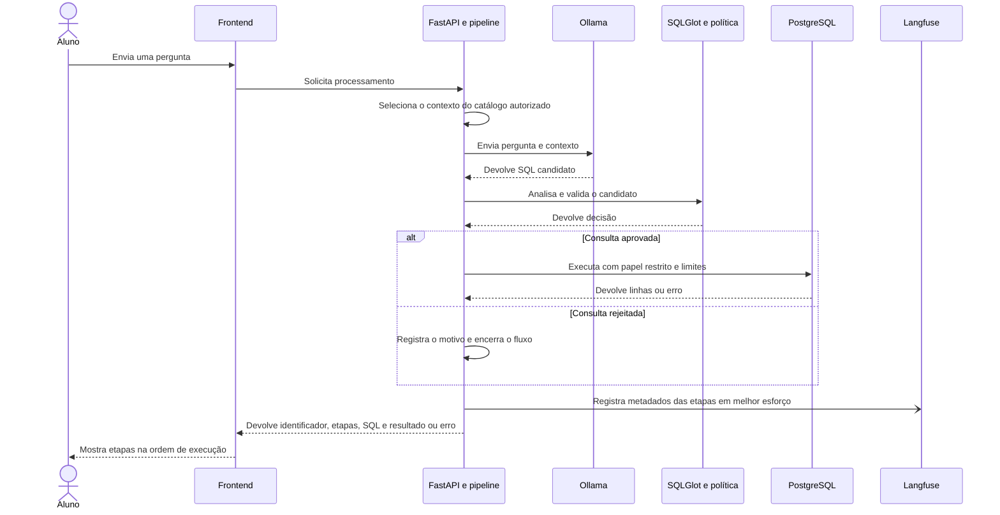

# Arquitetura proposta

O AI Query Playground será usado em ambiente acadêmico local, com uma base PostgreSQL sintética. Cada pergunta seguirá uma sequência de etapas explícitas no backend Python. O frontend recebe o resultado e as transições das etapas em tempo real para que o estudante possa relacionar o contexto fornecido ao modelo com o SQL produzido e a decisão de validação.

## Componentes

| Componente | Responsabilidade |
| --- | --- |
| React, Vite, TypeScript e Ant Design | Receber a pergunta e exibir contexto selecionado, SQL candidato, decisão de validação e resultado ou erro por etapa. Mostrar o SQL como texto. |
| FastAPI | Validar a entrada HTTP, atribuir um identificador à requisição e devolver o contrato consumido pela interface. |
| Pipeline Python | Obter o catálogo autorizado, montar o prompt versionado, chamar o modelo, validar o SQL e encaminhar apenas consultas aprovadas ao executor. |
| Ollama | Gerar um candidato SQL a partir da pergunta e do catálogo recebido. Sua resposta é tratada como entrada não confiável. |
| SQLGlot | Analisar o candidato com o dialeto PostgreSQL e apoiar a aplicação da política sobre a árvore sintática. |
| PostgreSQL | Armazenar os dados sintéticos e aplicar privilégios de leitura, timeout e isolamento da base acadêmica. |
| Langfuse | Correlacionar as etapas com seus tempos, estados e códigos de erro. |
| Docker Compose | Definir serviços, configurações locais e inicialização reproduzível da base sintética. |

## Fluxo de uma pergunta

No primeiro recorte, uma chamada HTTP retorna o histórico das etapas quando o processamento termina. Cada etapa tem nome, estado, duração quando disponível e motivo legível em caso de falha. As etapas posteriores a uma falha aparecem como não executadas. O catálogo inicial é gerado por introspecção do PostgreSQL. A API cruza a lista versionada de tabelas permitidas com as concessões de leitura e consulta metadados de colunas e chaves em uma transação somente leitura.

O endpoint `POST /api/query/generate` entrega o catálogo autorizado e a pergunta a um serviço de geração que depende da interface `LLMProvider`. O adaptador Ollama envia mensagens para `/api/chat` e solicita um JSON Schema. O serviço verifica o contrato Pydantic e distingue SQL candidato, ambiguidade e ausência de dados suficientes. A explicação resume características verificáveis da consulta. Os logs locais incluem identificadores, modelo, duração, tokens disponíveis e códigos de erro.

O endpoint `POST /api/query` aceita uma pergunta e percorre catálogo, geração, validação e execução. A política percorre a AST PostgreSQL e resolve referências a CTEs por escopo. O executor recebe o SQL renderizado da AST aprovada, com limite de 101 linhas para detectar truncamento após a centésima. A conexão usa `ai_query_reader`, transação somente leitura, `statement_timeout` de 3 segundos e `search_path` restrito a `pg_catalog`. A resposta carrega o identificador compartilhado com a geração e o estado e a duração de cada etapa percorrida.

A instrumentação própria registra uma observação raiz e spans para catálogo, prompt, geração, validação, execução e montagem da resposta. A API retorna o `trace_id` em JSON e no cabeçalho. O endpoint `POST /api/query/stream` transmite transições de etapa em SSE e termina com a resposta do mesmo pipeline. O exportador OTLP/HTTP envia resumos ao Langfuse em segundo plano, por fila limitada e com timeout. Veja a [documentação de observabilidade](observability.md).

## Interface local

A interface React e Ant Design consulta `/api/schema` e `/api/models` e envia a pergunta para `/api/query/stream`. O Vite encaminha as chamadas ao backend. A seleção explícita de modelo é conferida contra os modelos instalados no Ollama. Com `include_prompt: true`, a API devolve as mensagens exatas na resposta da requisição. O frontend renderiza o conteúdo como texto, e a instrumentação continua registrando somente resumos. O histórico guarda localmente as últimas 20 perguntas e metadados. O ID da trace e o identificador público do projeto constroem o link para o Langfuse.

O Docker Compose serve o build do Vite com Nginx e encaminha `/api/` ao FastAPI com buffering desabilitado para SSE. O backend inicia após o PostgreSQL aceitar leituras e o serviço de inicialização do Ollama confirmar o modelo. O Langfuse aguarda suas dependências de armazenamento. Seu envio de telemetria continua independente da prontidão da API.

## Controles de execução

- Use uma conexão de execução dedicada a uma base acadêmica, com papel sem privilégios administrativos e concessões de leitura apenas nos objetos aprovados. Rode a carga inicial com credenciais distintas.
- Exija uma única consulta de leitura. Analise a árvore inteira, inclusive subconsultas e CTEs. Restrinja relações e funções ao conjunto aprovado, com resolução explícita do esquema. Rejeite escrita, DDL, comandos administrativos, bloqueios e construções cuja segurança não possa ser comprovada pela política.
- Execute em transação somente leitura, com timeout e limite de linhas no backend. O timeout limita o tempo de execução mesmo quando poucas linhas são retornadas. Registre quando houver truncamento.
- Trate as instruções do prompt como orientação para geração. A autorização ocorre na validação estrutural e nas permissões do banco.
- Mantenha os serviços de apoio acessíveis pela rede interna do Compose sempre que possível. Use credenciais locais por configuração de ambiente e uma base sem dados pessoais.

## Decisões e consequências

- **Monorepo.** API, interface, ambiente e documentos podem evoluir na mesma revisão, o que facilita relacionar cada critério de aceite aos componentes envolvidos.
- **Pipeline explícito.** Uma sequência fixa em Python favorece testes por etapa e facilita localizar erros. O escopo inicial prevê uma geração por pergunta e não requer um framework de agentes.
- **Catálogo a partir do banco.** O contexto textual é derivado da mesma estrutura JSON devolvida pela API. A introspecção evita duplicar definições de tipos e chaves. A lista versionada delimita o conjunto exposto.
- **Resposta HTTP única.** A interface mostra a sequência completa ao final. Isso reduz a infraestrutura necessária para o primeiro recorte e adia a exibição em tempo real.
- **Telemetria em melhor esforço.** A resposta da API é suficiente para acompanhar uma pergunta. Langfuse acrescenta correlação e métricas entre sessões usando identificador, versão do prompt, modelo, duração e estado. A exportação tem limite de tempo e registra resumos de entrada e saída sem conteúdo bruto de perguntas, prompts, SQL ou linhas retornadas.
