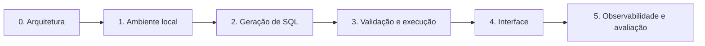

# Roadmap

Cada etapa termina com uma demonstração ou verificação registrada. A arquitetura inicial depende de aprovação antes do início da implementação.

## 0. Arquitetura e aprovação

**Entrega.** Estrutura do monorepo e documentos de arquitetura e planejamento.

**Critérios de aceite**

- O repositório reserva áreas para backend, frontend, infraestrutura e documentação.
- Os documentos explicam responsabilidades, fluxo, controles de execução e dependências entre etapas.
- A proposta é revisada e aprovada antes da implementação.

## 1. Ambiente local e base de estudo

**Entrega atual.** Stack local em Docker Compose, com PostgreSQL sintético, leitor dedicado, Ollama, backend, frontend e Langfuse. O Makefile reúne inicialização, operação, testes e benchmark.

**Critérios de aceite**

- O procedimento documentado sobe PostgreSQL e verifica a disponibilidade por meio de uma consulta autenticada com o papel de leitura.
- O Compose verifica a disponibilidade do Ollama, e o README documenta o download e a conferência do modelo.
- Uma inicialização limpa com a mesma data de referência recria os mesmos dados de estudo. O catálogo da API é conferido com o schema real no teste de integração.
- O papel de consulta consegue ler objetos autorizados e recebe erro ao tentar gravar ou consultar uma relação fora do catálogo.
- A configuração de exemplo permite identificar as variáveis necessárias sem incluir credenciais reais.

## 2. API e geração de SQL

**Entrega.** API FastAPI, catálogo PostgreSQL inspecionado com o papel de leitura e geração com Ollama a partir do catálogo autorizado.

**Revisão da geração.** O fluxo automatizado foi conferido com um Ollama simulado. O teste manual registrado ainda deixa pendente a classificação de perguntas ambíguas pelo modelo local. Também ficou pendente expor na resposta de erro o identificador registrado nos logs da geração.

**Critérios de aceite da API inicial**

- `GET /health` confirma a disponibilidade do banco com o usuário de leitura.
- `GET /api/schema` expõe as tabelas autorizadas, colunas, tipos, chaves e relacionamentos em JSON e em texto.
- Falhas de configuração e de acesso ao banco retornam erros legíveis sem expor credenciais.
- Swagger, curl e testes automatizados permitem verificar os dois endpoints.

**Critérios de aceite da geração**

- Uma pergunta de exemplo retorna identificador, contexto selecionado e SQL candidato, sem executar a consulta.
- O prompt tem versão identificável e recebe apenas o catálogo autorizado.
- Pergunta vazia, timeout e resposta inválida do modelo produzem erros identificáveis, com a etapa correspondente indicada.
- Um teste com resposta simulada do Ollama confirma o fluxo sem depender de variações do modelo.
- Perguntas ambíguas ou impossíveis de responder podem retornar um estado explícito e SQL nulo.
- Logs locais registram métricas da geração e resumos sem conteúdo sensível.

## 3. Validação e execução limitada

**Entrega.** Política SQLGlot e executor PostgreSQL com permissões restritas.

**Implementado.** `POST /api/query` devolve o histórico das quatro etapas e até 100 linhas, com indicação de truncamento. A suíte inclui integração com o PostgreSQL sintético e geração simulada, além de rejeições antes da execução.

**Critérios de aceite**

- Consultas de leitura permitidas retornam as linhas esperadas da base sintética.
- O validador rejeita múltiplas instruções, escrita, DDL, referências fora do catálogo, funções não autorizadas e operações proibidas dentro de CTEs ou subconsultas. Os casos rejeitados não chegam ao executor.
- Testes verificam o limite de linhas, o indicador de truncamento e o erro de timeout de execução.
- A API diferencia rejeição de política de falha durante a consulta.

## 4. Interface do playground

**Implementado.** Playground local em React e Ant Design, incluindo progressão via SSE, seletor de modelos, schema, prompt, SQL, validação, tabela, gráficos condicionais, métricas, histórico e trace.

**Entrega.** Interface React, Vite, TypeScript e Ant Design integrada à API.

**Critérios de aceite**

- O estudante consegue enviar uma pergunta e ver o estado de carregamento, as etapas em ordem e o SQL candidato.
- O resultado mostra colunas e linhas, com indicação de conjunto vazio ou truncamento quando aplicável.
- Uma rejeição mostra seu motivo, identifica a etapa que falhou e indica que a execução foi pulada. A interface permite enviar outra pergunta após o erro.
- A biblioteca didática do Playground apresenta cinco operações com diagramas de Venn e relaciona predicados booleanos à álgebra relacional. A seleção de um exemplo preenche a pergunta editável e mantém a execução sob controle do usuário.

## 5. Observabilidade e avaliação acadêmica

**Implementado.** Langfuse local com rastreamento por pergunta, instrumentação própria e SSE. `make benchmark` executa um conjunto inicial versionado, compara resultados com referências da base sintética e registra erros, latências, tokens e IDs de trace em JSON.

**Entrega.** Rastreamento com Langfuse e roteiro reproduzível de avaliação.

**Critérios de aceite**

- Uma requisição bem-sucedida e uma rejeitada podem ser correlacionadas com seus rastros pelo identificador da API.
- Os rastros mostram versão do prompt, modelo, estado e duração por etapa concluída, sem conteúdo bruto de perguntas, prompts, SQL ou resultados na configuração padrão.
- Com Langfuse indisponível, a API continua respondendo dentro dos limites definidos.
- Um conjunto versionado de perguntas com resultados esperados mede acerto por equivalência de resultado, além de rejeições, falhas e latência. O roteiro mantém registrados o modelo, a versão do prompt e a versão da base usados na avaliação.

### Avaliação experimental de Text-to-SQL

**Implementado.** Suíte com 105 perguntas e 15 categorias teóricas sobre o schema real, snapshot determinístico verificado por hash, referência independente, comparação por multiconjunto ou sequência, tolerância numérica e verificações estruturais da AST. A página **Avaliação Experimental** executa perguntas ou categorias em modelos locais e exporta tentativas em CSV e JSON. O procedimento de reprodução e os critérios de pontuação estão na [metodologia experimental](experimental-evaluation.md).

**Verificado.** As referências versionadas foram reproduzidas em PostgreSQL 18.6 com a carga sintética fixa. Os testes de integração cobrem classificação, resultado, construção SQL, rejeição pela política e divergência de snapshot. As métricas comparativas serão obtidas ao executar a suíte com os modelos reais.

**Dois modos de avaliação.** A avaliação dinâmica usa o banco atual e calcula as referências na mesma transação do candidato. O modo científico preserva a conferência de hash e permite selecionar um manifesto versionado por configuração. A interface informa o modo, identifica os dados usados e apresenta tentativas com dados insuficientes.

**Operação experimental.** O Makefile reúne os alvos de recarga local, reconstrução, seed protegida e operação científica por data. A auditoria confere o hash e as referências. O benchmark chama a API científica, aceita recortes e preserva o histórico em CSV e JSON. A rodada completa é explícita e percorre os modelos locais sequencialmente.
